# VPS Tracker

**VPS Tracker** — self-hosted учёт виртуальных серверов: где они стоят, сколько стоят, когда продлевать, сколько денег осталось у хостера и доступны ли с них нужные сервисы. Данные синхронизируются с биллингом хостеров (BILLmanager и др.), хранятся в одном SQLite-файле у вас на сервере, интерфейс работает в браузере и на телефоне.

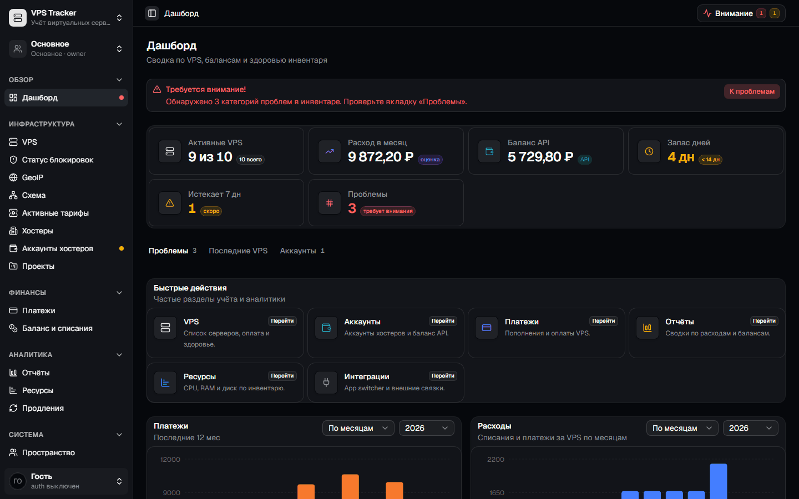

> Все скриншоты сделаны на демо-данных: хостеры вымышленные, IP из документационных диапазонов (RFC 5737). Как пересоздать — [docs/screenshots/README.md](docs/screenshots/README.md).

---

## Главное

| | |
|---|---|
| 🖥️ **Инвентарь VPS** | IP/IPv6, DNS, локация с флагом, ресурсы, ОС, проект, окружение, статус, произвольные поля, массовые действия |
| 🔄 **Синхронизация с хостерами** | BILLmanager 6, 4VPS, Маклауд, VDSina, Veesp, RuVDS: серверы, платежи, баланс, тарифы — вручную или по расписанию |
| 💰 **Деньги под контролем** | Платежи, журнал баланса, расход в месяц, «запас дней» до нуля, календарь продлений, отчёты и CSV-экспорт; мультивалютность с курсами ЦБ |
| 🩺 **Здоровье инвентаря** | Uptime-проверки по TCP, истекающая оплата, низкий баланс, расхождения API и журнала — всё на дашборде |
| 🌍 **Блокировки и GeoIP** | Проверка доступности сервисов (YouTube, ChatGPT, Discord…) и GeoIP-страны прямо с VPS или MikroTik одной командой |
| 🗺️ **Схема инфраструктуры** | Визуальный редактор: VPS, связи (сеть, туннель, VPN, зависимость), группы и сервисы CFDM |
| 🔔 **Уведомления** | Telegram (в т.ч. топики и свой Bot API) и webhook: оплата, низкий баланс, дайджест синка, новые тарифы, VPS упал/поднялся |
| 👥 **Команда и пространства** | SSO через auth-portal (JWT), личные и общие пространства с ролями, шаринг VPS между пространствами, журнал изменений |
| 💾 **Бэкапы** | Выгрузка/загрузка JSON или файла БД из интерфейса; данные — один файл `vps-tracker.db` |

Подробно по каждому разделу — **[docs/features.md](docs/features.md)**. Переменные окружения, роли и права — **[docs/configuration.md](docs/configuration.md)**.

---

## Скриншоты

| | |
|---|---|
| 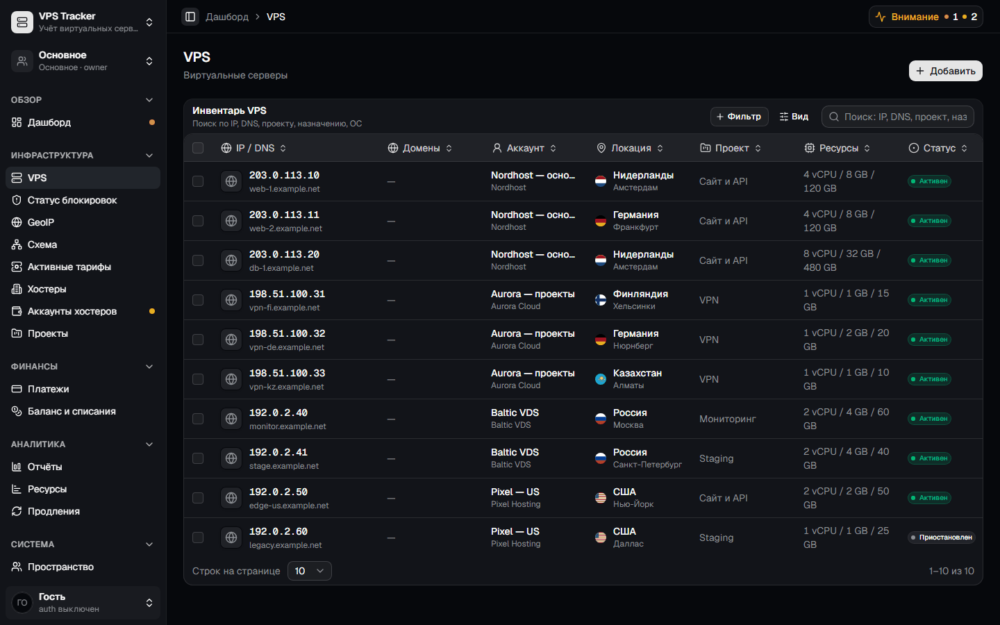 | 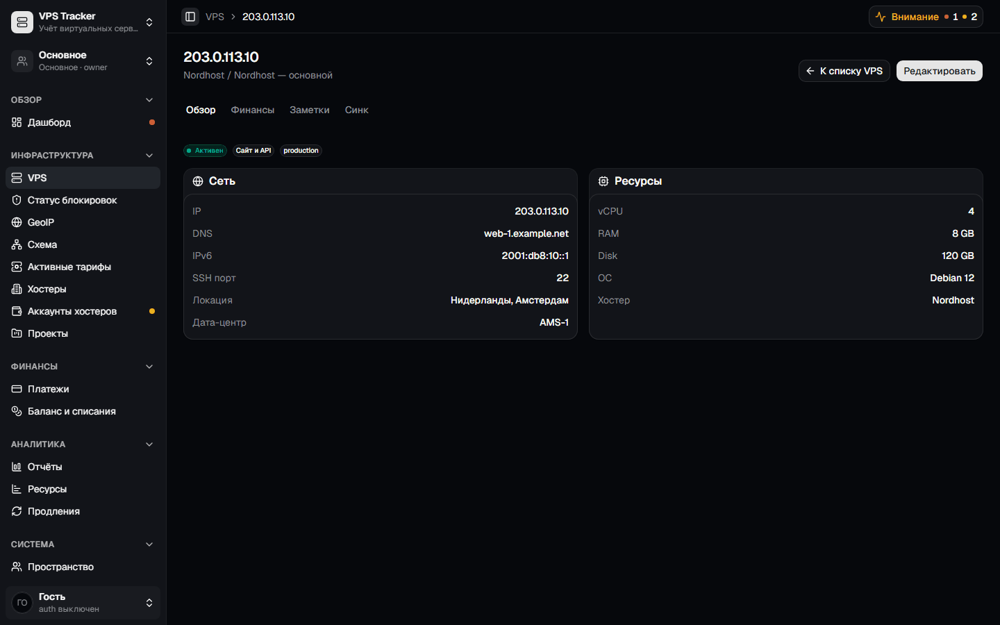 |
| **VPS** — инвентарь с фильтрами, видами и массовыми действиями | **Карточка VPS** — сеть, ресурсы, финансы, заметки, синк |
| 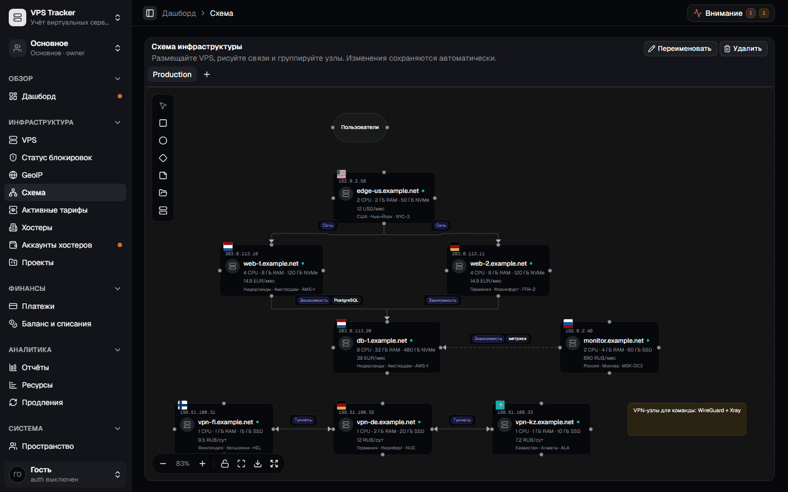 | 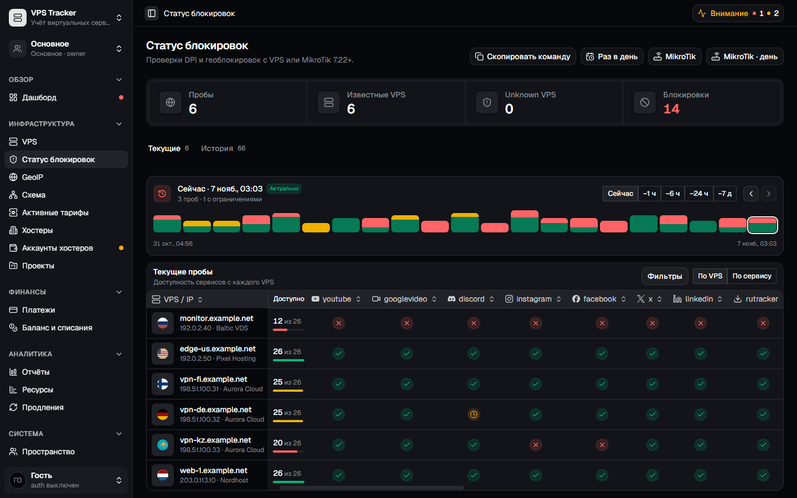 |
| **Схема** — редактор топологии с узлами VPS и типами связей | **Блокировки** — доступность сервисов с каждого VPS |
| 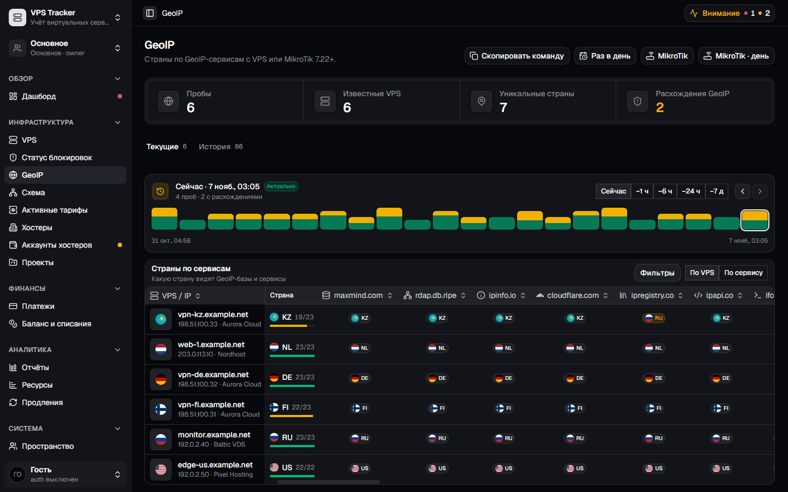 | 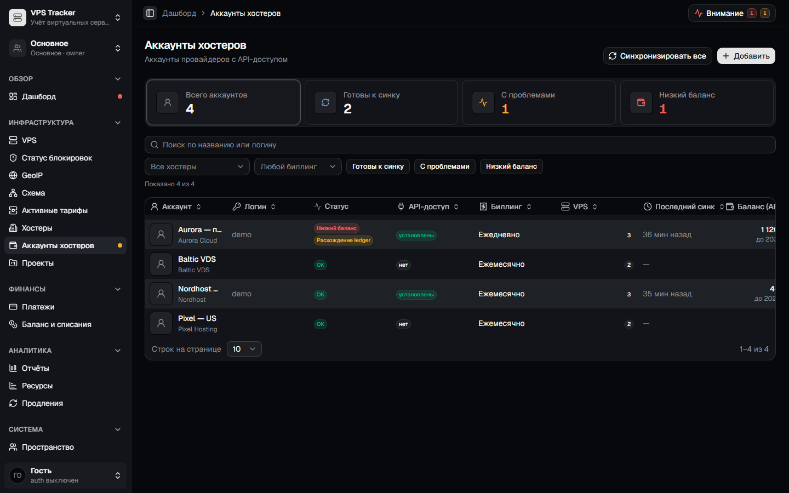 |
| **GeoIP** — какую страну видят GeoIP-базы и сервисы | **Аккаунты** — баланс по API, готовность к синку, пороги |
| 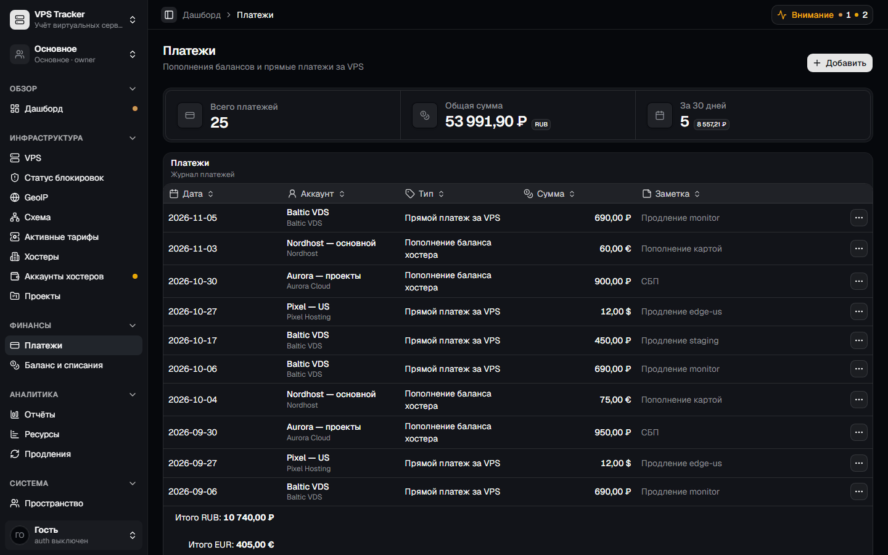 | 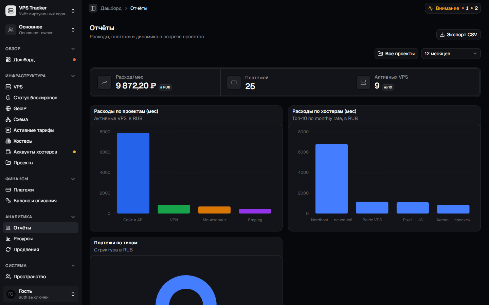 |
| **Платежи** — пополнения и прямые оплаты, итоги по валютам | **Отчёты** — расходы по проектам и хостерам, CSV |
| 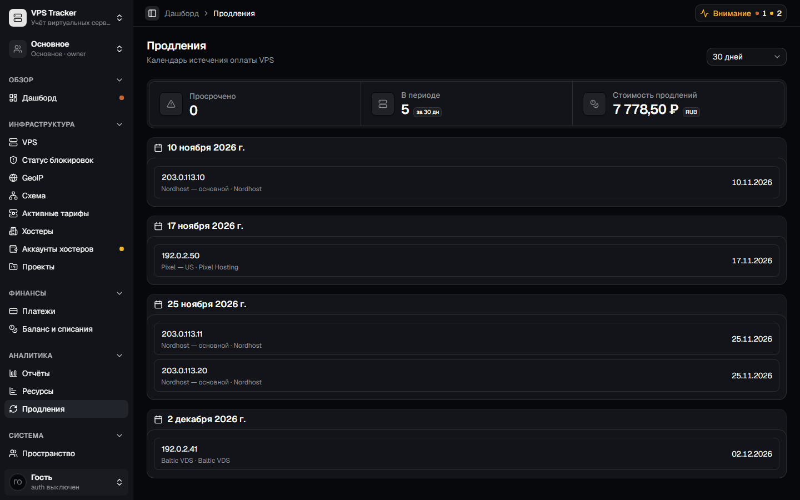 | 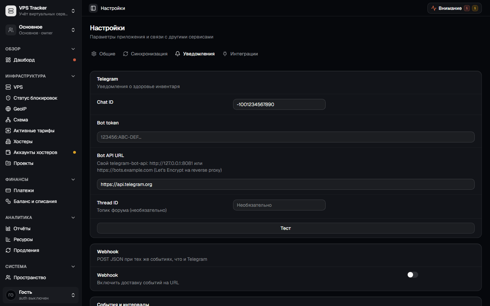 |
| **Продления** — календарь ближайших оплат | **Уведомления** — Telegram и webhook |

<p align="center">
  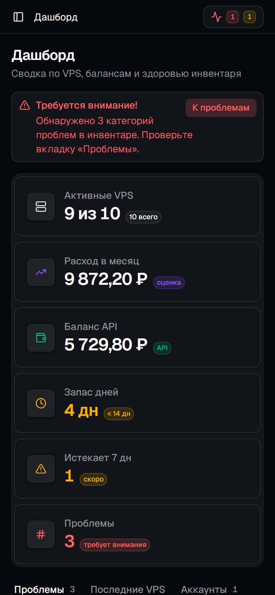
  &nbsp;
  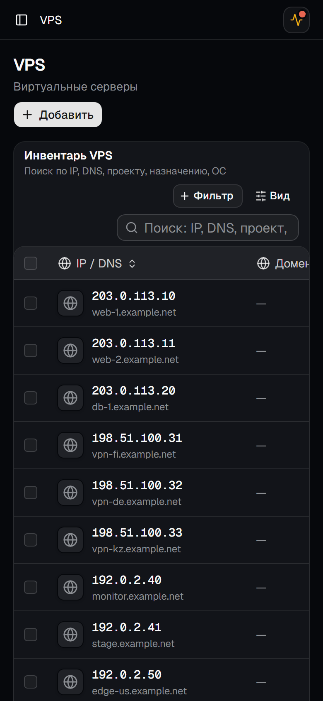
</p>

---

## Быстрый старт (Docker)

Нужны Linux-сервер (или любая машина) с [Docker](https://docs.docker.com/engine/install/). Node.js ставить не нужно.

```bash
mkdir -p ~/vps-tracker-data
docker run -d \
  --name vps-tracker \
  --restart unless-stopped \
  -p 3001:3001 \
  -v ~/vps-tracker-data:/app/data \
  ghcr.io/denozordec/vps-tracker:latest
```

Откройте **http://localhost:3001** (или `http://IP_СЕРВЕРА:3001`). База появится в `~/vps-tracker-data/vps-tracker.db`.

> **`docker pull` просит логин?** Пакет на GitHub может быть закрытым: войдите через [Personal Access Token](https://github.com/settings/tokens) с правом `read:packages` — `echo ТОКЕН | docker login ghcr.io -u ЛОГИН --password-stdin` — или сделайте пакет public в его настройках.

Первые шаги в интерфейсе:

1. **Хостеры** → добавьте хостера; для синка укажите тип API и URL биллинга.
2. **Аккаунты хостеров** → добавьте аккаунт с логином/токеном API и нажмите «Синхронизировать» — серверы, платежи и баланс подтянутся сами.
3. **Настройки → Общие** → базовая валюта и URL курсов (например `https://www.cbr-xml-daily.ru/daily_json.js`).
4. **Настройки → Синхронизация / Уведомления** → автосинк по расписанию и Telegram.

---

## Варианты установки

### Docker Compose

В [docker-compose.yml](docker-compose.yml) уже указан образ с GHCR, данные — в `./data`:

```bash
git clone https://github.com/denozordec/vps-tracker.git
cd vps-tracker
docker compose up -d
```

### Production: Traefik + HTTPS (Cloudflare DNS-01)

Готовый compose с Traefik и Let's Encrypt, без публикации порта `3001` наружу, плюс короткий домен для launcher-скриптов блокировок/GeoIP:
**[docs/deploy-traefik.md](docs/deploy-traefik.md)** · [`deploy/docker-compose.traefik.yml`](deploy/docker-compose.traefik.yml) · [`deploy/env.traefik.example`](deploy/env.traefik.example)

```bash
mkdir -p /opt/vps-tracker/data && cd /opt/vps-tracker
curl -fsSL -o docker-compose.yml https://raw.githubusercontent.com/denozordec/vps-tracker/main/deploy/docker-compose.traefik.yml
curl -fsSL -o .env https://raw.githubusercontent.com/denozordec/vps-tracker/main/deploy/env.traefik.example
nano .env   # CF_DNS_API_TOKEN, LETSENCRYPT_EMAIL, VPS_DOMAIN
docker compose pull && docker compose up -d
curl -fsS https://ВАШ_ДОМЕН/health
```

### Свой образ из исходников

```bash
docker build -t vps-tracker:local .
docker run -d --name vps-tracker --restart unless-stopped \
  -p 3001:3001 -v "$(pwd)/data:/app/data" vps-tracker:local
```

---

## Данные, бэкап и обновление

- **Всё хранится в одном файле** `vps-tracker.db` (SQLite) в смонтированной папке (`/app/data` в контейнере). Скопировать его — и есть бэкап.
- **Из интерфейса:** *Настройки → Общие* — выгрузка/загрузка JSON-бэкапа и файла БД (при включённой авторизации — только глобальный админ).
- **Старые базы** обновляются автоматически при старте: недостающие колонки и таблицы добавляются, данные не теряются.
- **Журналы чистятся сами:** уведомления и журнал синка старше 90 дней, uptime-проверки старше 30 дней.

Обновление:

```bash
docker pull ghcr.io/denozordec/vps-tracker:latest
docker stop vps-tracker && docker rm vps-tracker
# и снова docker run из «Быстрого старта» с тем же -v …:/app/data
```

С Compose: `git pull && docker compose up -d` (`pull_policy: always` подтянет свежий образ).

Версии: каждый релиз — git-тег `vX.Y.Z` и образ `ghcr.io/denozordec/vps-tracker:X.Y.Z` (и `:X.Y`); `latest` — текущий `main`. Чтобы не обновляться неожиданно, закрепите версию: `ghcr.io/denozordec/vps-tracker:1.0.0`. Текущая версия видна в меню пользователя и в ответе `GET /health`.

Другой порт снаружи: `-p 8080:3001` → `http://localhost:8080`. Сменить порт внутри контейнера: `-e PORT=8080 -p 8080:8080`.

---

## Документация

| Документ | О чём |
|---|---|
| [docs/features.md](docs/features.md) | Все разделы интерфейса и как ими пользоваться |
| [docs/configuration.md](docs/configuration.md) | Переменные окружения, авторизация, роли, синк, уведомления, планировщик |
| [docs/deploy-traefik.md](docs/deploy-traefik.md) | Production за Traefik с HTTPS |
| [docs/screenshots/README.md](docs/screenshots/README.md) | Демо-данные и пересъёмка скриншотов |
| [apps/api/src/services/billmanager/profiles/README.md](apps/api/src/services/billmanager/profiles/README.md) | Как добавить профиль нового BILLmanager-хостера |
| [AGENTS.md](AGENTS.md) | Архитектура и карта кода (для разработчиков и ИИ-агентов) |

---

## Для разработчиков

Monorepo на **pnpm**: `apps/web` (Vite + React 19 + TanStack Router/Query + shadcn/ui + ReUI), `apps/api` (Fastify 5), `packages/db` (Drizzle + better-sqlite3), `packages/shared` (Zod-контракты).

```bash
pnpm install
pnpm --filter api dev      # API на :3001 (база — apps/api/data/vps-tracker.db или DB_PATH)
pnpm --filter web dev      # фронтенд с hot reload
pnpm --filter api test     # тесты API (Vitest)
pnpm --filter web test     # тесты фронтенда
pnpm --filter web build    # production-сборка фронтенда
```

Демо-данные для разработки: `cd apps/api && DB_PATH=../../data/demo.db VITEST=1 npx tsx scripts/seed-demo.ts --serve` → http://127.0.0.1:3101.

Подробнее об устройстве кода — [AGENTS.md](AGENTS.md).
