# Возможности VPS Tracker

Гид по всем разделам интерфейса. Скриншоты — на демо-данных (вымышленные хостеры, IP из RFC 5737).

**Содержание**

1. [Дашборд](#дашборд)
2. [VPS и карточка сервера](#vps-и-карточка-сервера)
3. [Проекты](#проекты)
4. [Схема инфраструктуры](#схема-инфраструктуры)
5. [Хостеры, аккаунты и синхронизация](#хостеры-аккаунты-и-синхронизация)
6. [Активные тарифы](#активные-тарифы)
7. [Платежи, баланс и продления](#платежи-баланс-и-продления)
8. [Отчёты и ресурсы](#отчёты-и-ресурсы)
9. [Статус блокировок](#статус-блокировок)
10. [GeoIP](#geoip)
11. [Уведомления](#уведомления)
12. [Пространства, пользователи и роли](#пространства-пользователи-и-роли)
13. [Журналы](#журналы)
14. [Настройки, интеграции и бэкапы](#настройки-интеграции-и-бэкапы)

---

## Дашборд

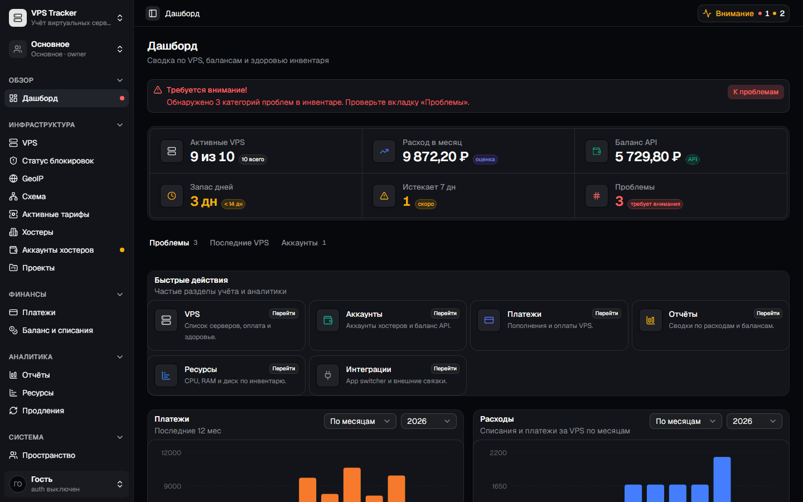

Одна страница, чтобы понять, всё ли в порядке:

- **KPI**: активные VPS, расход в месяц (в базовой валюте), суммарный баланс у хостеров по API, **запас дней** — на сколько хватит денег при текущем расходе, сколько VPS истекает в ближайшие 7 дней, число проблем.
- **Баннер «Требуется внимание»** и кнопка «Внимание» в шапке собирают проблемы инвентаря: истекающая оплата, низкий баланс, давно не синхронизированные аккаунты, расхождение баланса API и журнала.
- **Быстрые действия** — переходы в частые разделы (можно скрыть в настройках).
- **Графики** платежей и расходов по месяцам и таблица «Здоровье инвентаря» с CSV-экспортом.

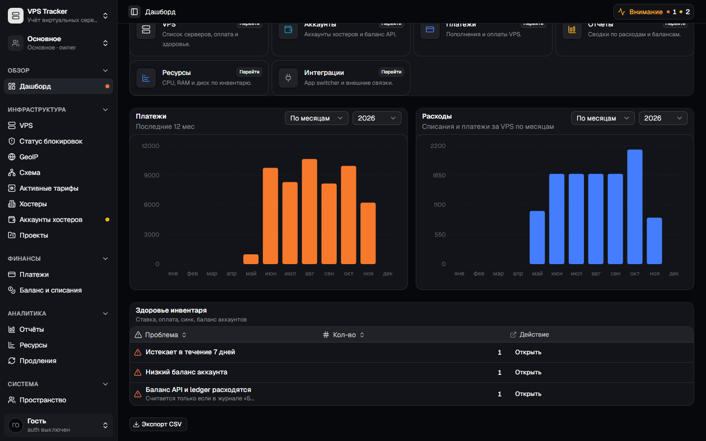

Все суммы в разных валютах пересчитываются в базовую: по курсу хостера (если задан в карточке хостера) или по курсам из URL в настройках (формат ЦБ РФ `cbr-xml-daily` или `{ base, rates }`).

---

## VPS и карточка сервера

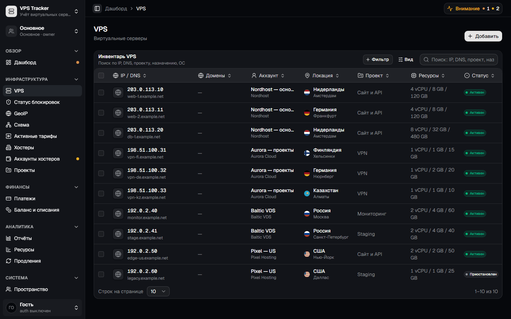

- Таблица с поиском по IP, DNS, проекту, назначению и ОС; фильтры, настраиваемые колонки (вид), сортировка.
- Для каждого сервера: IP/IPv6 и доп. адреса, домены (из CFDM), аккаунт и хостер, страна/город/ДЦ с флагом, CPU/RAM/диск, проект, статус, тариф (дневной/месячный), оплачено до.
- **Массовые действия**: выделите несколько VPS — сменить статус или проект, удалить.
- **Произвольные поля** (настраиваются в *Настройки → Общие*) появляются в таблице и форме.
- Поля, изменённые вручную, запоминаются как «пользовательские» — синхронизация с хостером их не перезаписывает.

Карточка сервера разбита на вкладки: **Обзор** (сеть и ресурсы), **Финансы** (тариф, дата оплаты и связанные платежи), **Заметки**, **Синк** (что пришло от хостера).

| | |
|---|---|
| 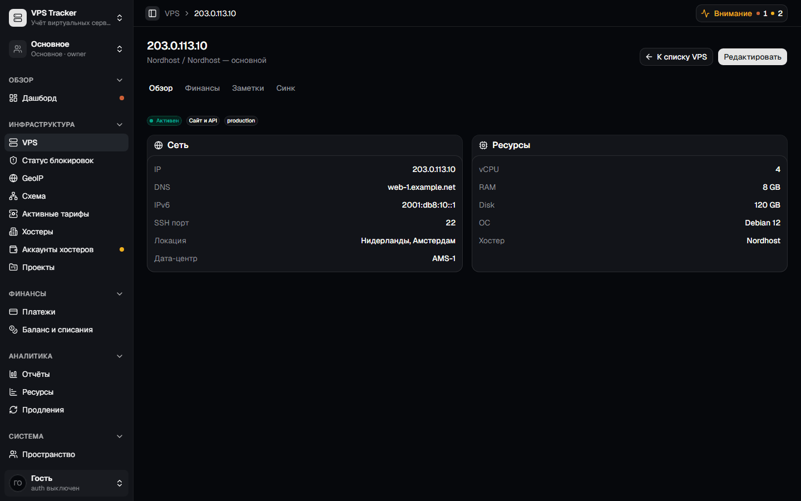 | 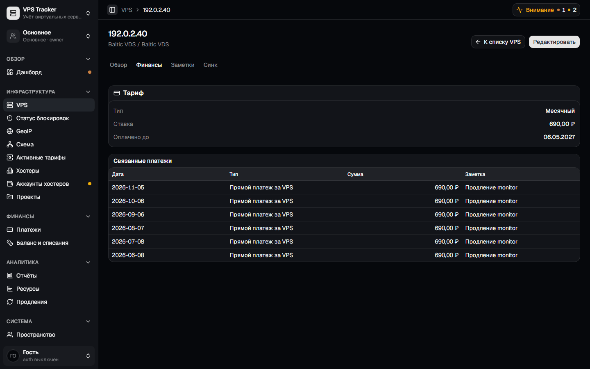 |

**Дата «оплачено до»** считается автоматически: из поля хостера, а для дневного тарифа — из баланса аккаунта и суточного списания; прямые платежи за VPS продлевают дату.

**Uptime-мониторинг**: для VPS с включённым мониторингом раз в N минут (по умолчанию 5) проверяется TCP-доступность SSH-порта. Переходы «упал/поднялся» попадают в уведомления и историю проверок.

---

## Проекты

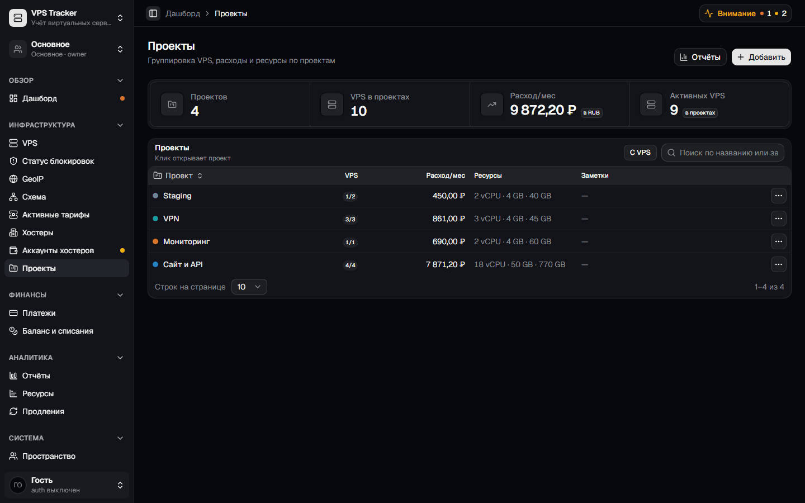

Группировка серверов по проектам (цвет, заметки). Для каждого — количество VPS, расход в месяц и суммарные ресурсы. Карточка проекта показывает его VPS и быстрые переходы в отчёты.

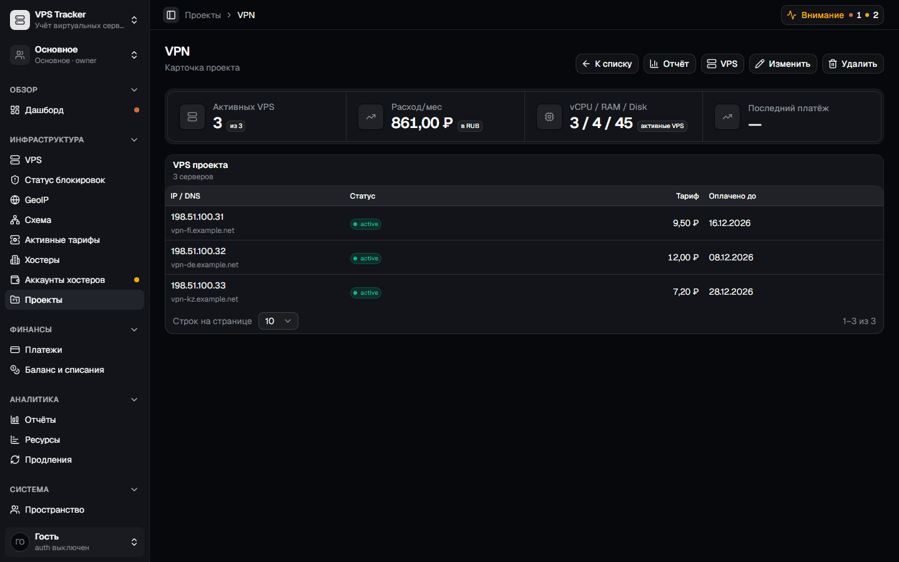

Проект можно указать прямо в форме VPS: существующий находится без учёта регистра (в том числе кириллица), новый создаётся автоматически.

---

## Схема инфраструктуры

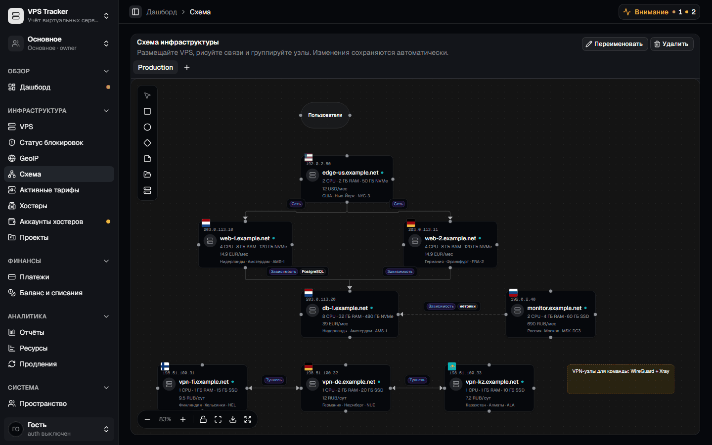

Редактор топологии на React Flow:

- узлы **VPS** (с флагом, IP, ресурсами, ценой и статусом uptime), фигуры, заметки, группы;
- **связи** с типом (сеть, зависимость, туннель, VPN, синхронизация, произвольная), направлением, стилем линии, подписью, протоколом и IP концов туннеля;
- **сервисы CFDM** — отдельные узлы с членством VPS (для балансировки/HA);
- несколько схем во вкладках, блокировка от случайных правок, экспорт в PNG, автосохранение.

---

## Хостеры, аккаунты и синхронизация

| | |
|---|---|
| 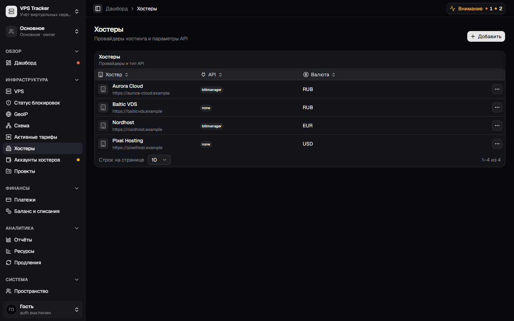 | 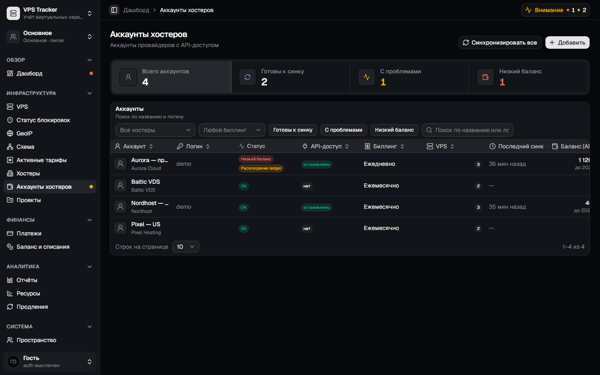 |

**Хостер** — компания (сайт, базовая валюта, курсы USD/EUR для пересчёта) и **тип API** с URL биллинга — один на хостера.
**Аккаунт** — ваш логин у хостера: учётные данные API, режим оплаты (ежедневно/ежемесячно), порог низкого баланса. Пароли API в интерфейс не возвращаются — видно только, что они заданы, и логин.

Поддерживаемые API:

| Тип | Что нужно в аккаунте | Что синхронизируется |
|---|---|---|
| **BILLmanager 6** | логин и пароль API | VPS, платежи, баланс, тарифы `vds.order` по всем ДЦ |
| **4VPS** | Panel ID и API Key | VPS, баланс, тарифы |
| **Маклауд / VDSina** (userapi) | API Token | VPS, операции, баланс, тарифы |
| **Veesp** | email и пароль client area | VPS, счета, баланс, тарифы |
| **RuVDS** | API-токен из ЛК | VPS, платежи, баланс, тарифы |

Для разных BILLmanager-хостеров есть **профили** с особенностями их API (FirstByte, IHOR, DataCheap, Serv.host, WaiCore, LandVPS, Cloudrix…) — новый добавляется одним файлом, см. [profiles/README.md](../apps/api/src/services/billmanager/profiles/README.md).

Синхронизация запускается кнопкой на аккаунте («Синхронизировать» / «Синхронизировать все») или по расписанию (*Настройки → Синхронизация*: интервал синка VPS и платежей — от 15 минут, тарифов — от 60 минут). Повторный запуск во время идущего синка того же аккаунта отклоняется. Каждый запуск пишется в [журнал синка](#журналы).

---

## Активные тарифы

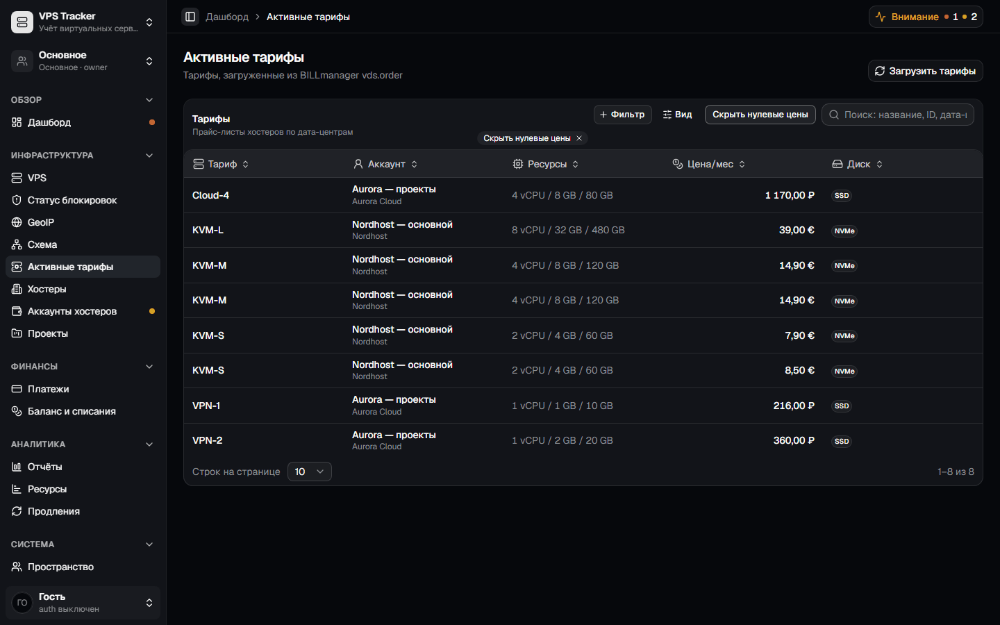

Прайс-листы хостеров, загруженные через API: ресурсы, цена, ДЦ, доступность к заказу. Удобно сравнивать хостеров и замечать новые тарифы — о них приходит уведомление. Если загрузка прайс-листа не удалась, сохранённый список не стирается.

---

## Платежи, баланс и продления

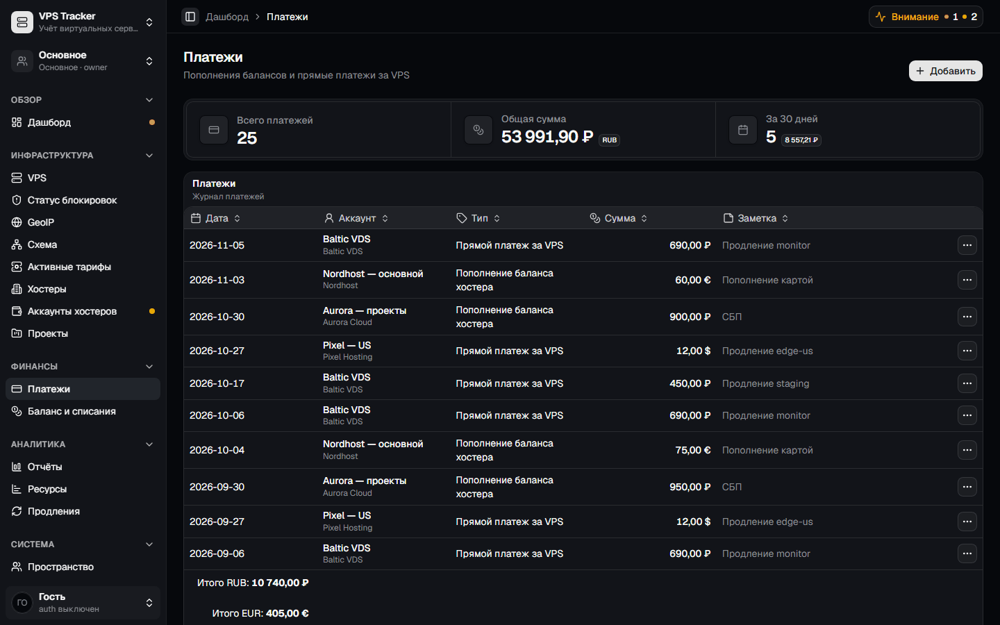

- **Платежи** — пополнения баланса хостера и прямые оплаты VPS (привязка к аккаунту и/или серверу необязательна), итоги по валютам, импорт из синка без дублей.
- **Баланс и списания** — журнал движений по балансу (приход/расход), сводка и чистый остаток.
- **Продления** — календарь ближайших оплат на 7/30/90 дней и стоимость продлений.

| | |
|---|---|
| 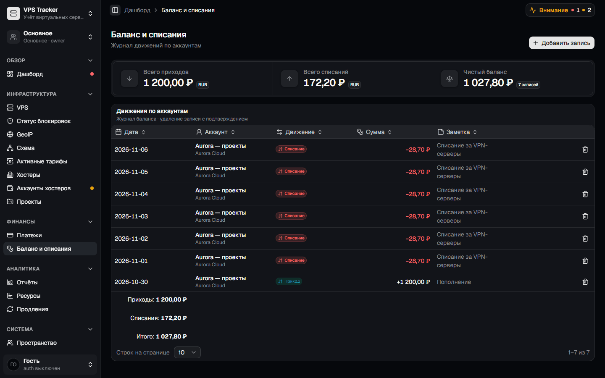 | 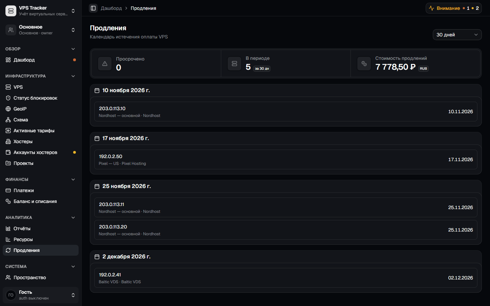 |

---

## Отчёты и ресурсы

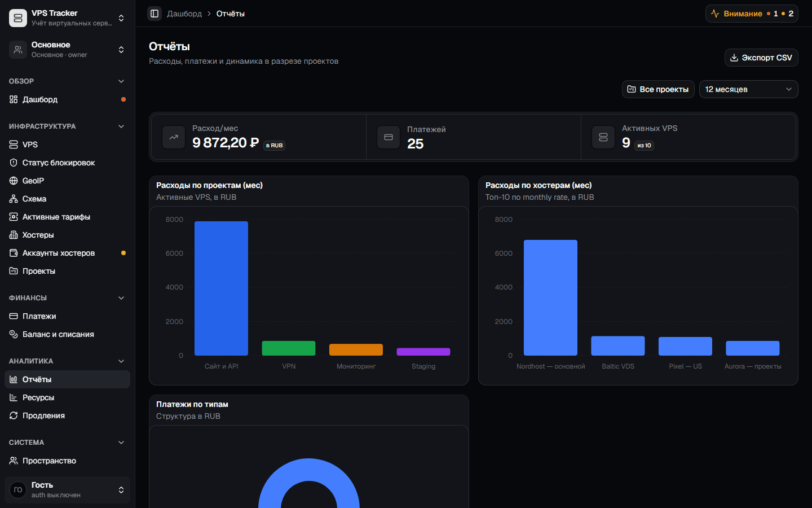

- **Отчёты**: расход в месяц по проектам и хостерам, платежи по типам, фильтр по проекту и периоду, экспорт в CSV.
- **Ресурсы**: суммарные vCPU/RAM/диск активных VPS и распределение по хостерам.

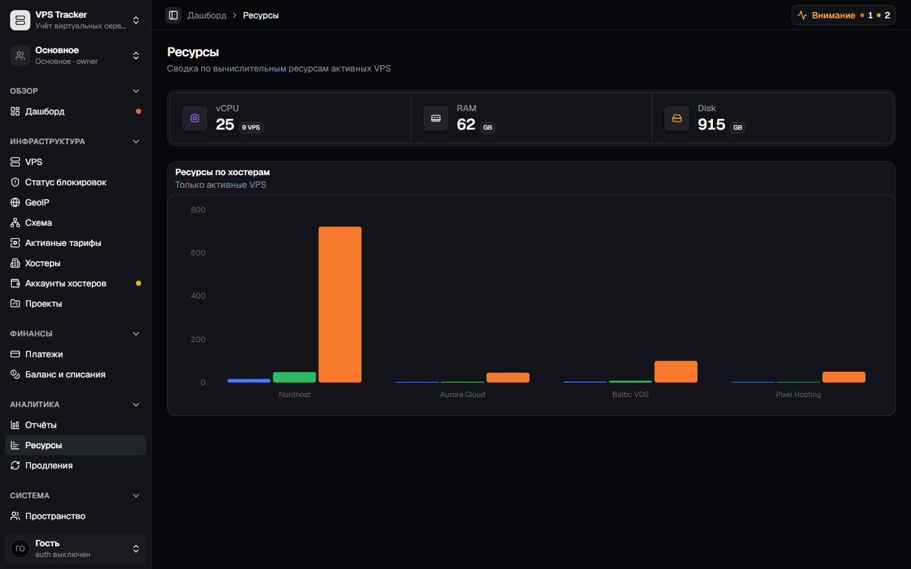

---

## Статус блокировок

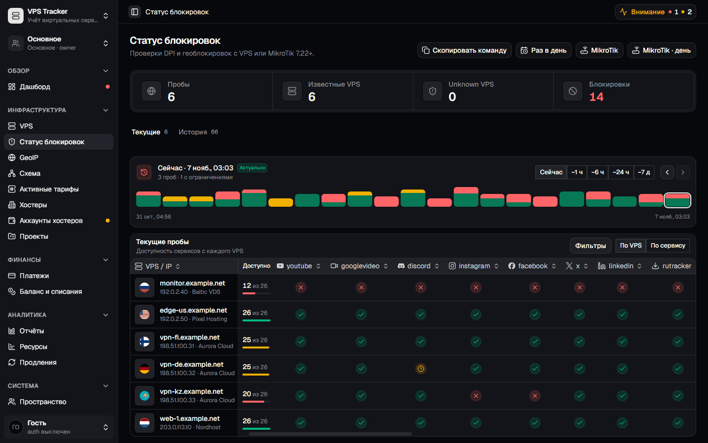

Проверка доступности популярных сервисов **с самого VPS** (через [censorcheck](https://github.com/vernette/censorcheck)): доступен, заблокирован, отказ (403), редирект, таймаут. Результат автоматически привязывается к VPS по IP.

- **Шкала времени**: каждая капсула — час с измерениями; высота — число проб, красная/жёлтая часть — доля прогонов с ограничениями. Переход кликом, кнопками ‹ ›, клавишами ← → или пресетами «Сейчас / −1 ч / −6 ч / −24 ч / −7 д» — матрица показывает состояние на выбранный момент.
- **Матрица**: строка — VPS с флагом страны, колонка — сервис с иконкой бренда; цветной значок статуса и колонка «Доступно X из Y» с полосой. Переключение «По VPS / По сервису», фильтры по статусу, сервису, хостеру, стране; клик открывает детали прогона.
- **История** — все сохранённые прогоны.

Запуск на сервере — одна команда (скрипт ставит недостающие `jq`/`dig`, показывает прогресс и отправляет результат с одноразовым токеном):

```bash
curl -fsSL https://vt.example.com/cc | bash                     # разовая проверка
curl -fsSL https://vt.example.com/cc | bash -s -- --daily       # раз в сутки (cron)
curl -fsSL https://vt.example.com/cc | bash -s -- --remove-daily
```

**MikroTik (RouterOS 7.22+)** — пробы идут через указанный исходящий IP:

```
:global "vt-srcIp" "1.2.3.4"; /tool fetch url="https://vt.example.com/cc.rsc" dst-path=vt-cc.rsc; /import file-name=vt-cc.rsc
```

(`?daily=1` — ежедневный scheduler, `?remove=daily` — удалить.) Кнопки «Скопировать команду», «Раз в день», «MikroTik» на странице подставляют ваш домен. Нужны `CENSORCHECK_INGEST_SECRET` и `CENSORCHECK_PUBLIC_URL` — см. [configuration.md](configuration.md#блокировки-и-geoip).

---

## GeoIP

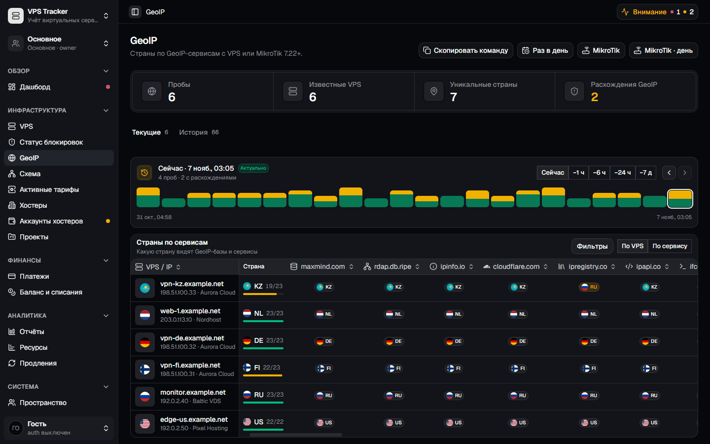

Какую страну видят у вашего IP GeoIP-базы (MaxMind, RIPE, ipinfo, Cloudflare…) и сервисы (Google, YouTube, Netflix, ChatGPT…), включая CDN, — через [ipregion](https://github.com/vernette/ipregion).

- Ячейки матрицы — флаг и ISO-код страны; сервис, который видит **другую** страну, чем большинство, подсвечен жёлтым.
- Колонка «Страна» — итоговая страна по большинству и «совпадает N из M».
- Та же шкала времени, что у блокировок: жёлтые капсулы — часы с расхождениями.

Запуск так же, как у блокировок: `curl -fsSL https://vt.example.com/ic | bash` (`--daily`, `--remove-daily`), для MikroTik — `ic.rsc`.

---

## Уведомления

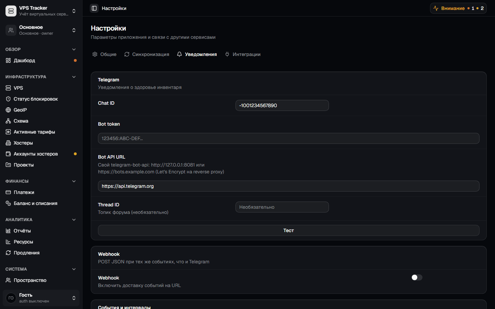

Каналы: **Telegram** (Chat ID, несколько чатов через запятую, топики форума через Thread ID, свой Bot API URL для прокси) и **webhook** (POST JSON). Кнопка «Тест» проверяет настройки и подсказывает типичные ошибки (бот не в чате, неверный токен, нет топика).

| Событие | Когда | Повтор |
|---|---|---|
| Истекает оплата | VPS с оплатой в ближайшие 7 дней | не чаще раза в сутки для того же набора |
| Низкий баланс | баланс аккаунта по API ниже порога | раз в сутки |
| Дайджест синка | после планового синка, если что-то изменилось | при новых изменениях |
| Новые тарифы | у хостера появились тарифы | при новом наборе |
| VPS недоступен / восстановлен | переход статуса uptime-проверки | каждый переход |

Каждое событие включается отдельно. Все отправки (и пропуски-дубли) видны в журнале уведомлений. Длинные сообщения обрезаются по строкам под лимит Telegram, имена из API экранируются.

---

## Пространства, пользователи и роли

При включённой авторизации (`AUTH_REQUIRED=true`) вход идёт через **auth-portal** (JWT), а данные разделены на **пространства**:

- у каждого пользователя есть личное пространство; есть общее «Основное» и можно создавать командные;
- роли в пространстве: **owner → admin → member → viewer**. Viewer только смотрит; member меняет VPS, платежи, хостеров, аккаунты и запускает синк; admin управляет настройками и участниками;
- **шаринг VPS**: сервер можно показать в другом пространстве (чтение/запись) или передать целиком;
- удалённые пространства попадают в корзину и восстанавливаются;
- права портала (`vps:<раздел>:read|write|admin`) ограничивают разделы поверх ролей — см. [configuration.md](configuration.md#авторизация-и-права).

Синхронизация, уведомления, uptime и интеграции работают отдельно для каждого пространства.

---

## Журналы

| | |
|---|---|
| 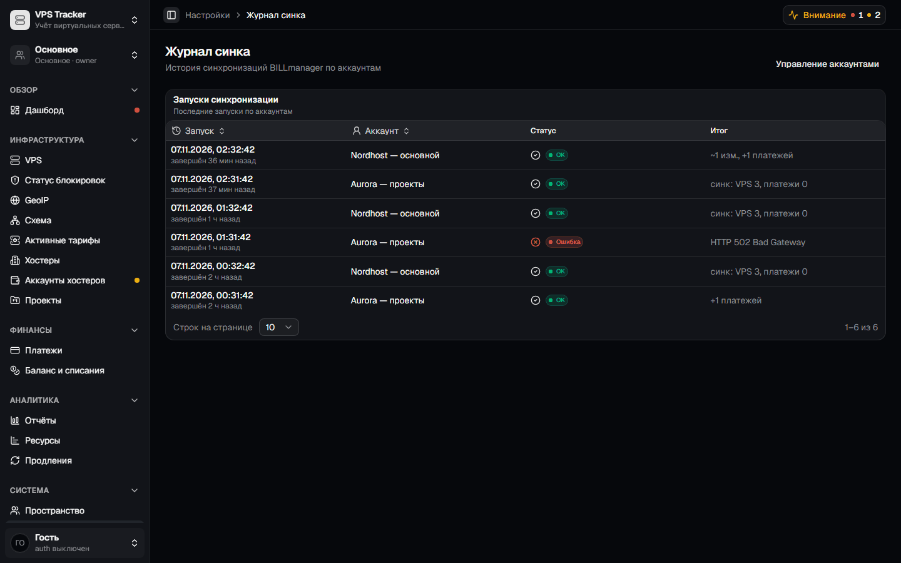 | 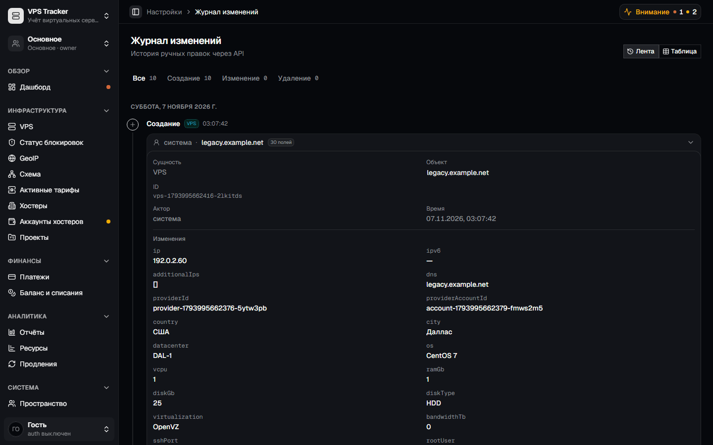 |

- **Журнал синка** — каждый запуск по аккаунтам: время, длительность, статус, что изменилось или текст ошибки.
- **Журнал изменений** — кто, когда и что поменял (создание/изменение/удаление) с diff полей; лента или таблица. При настроенном портале события дублируются в его аудит.

Старые записи журналов удаляются автоматически (уведомления и синк — 90 дней, uptime-проверки — 30 дней).

---

## Настройки, интеграции и бэкапы

| | |
|---|---|
| 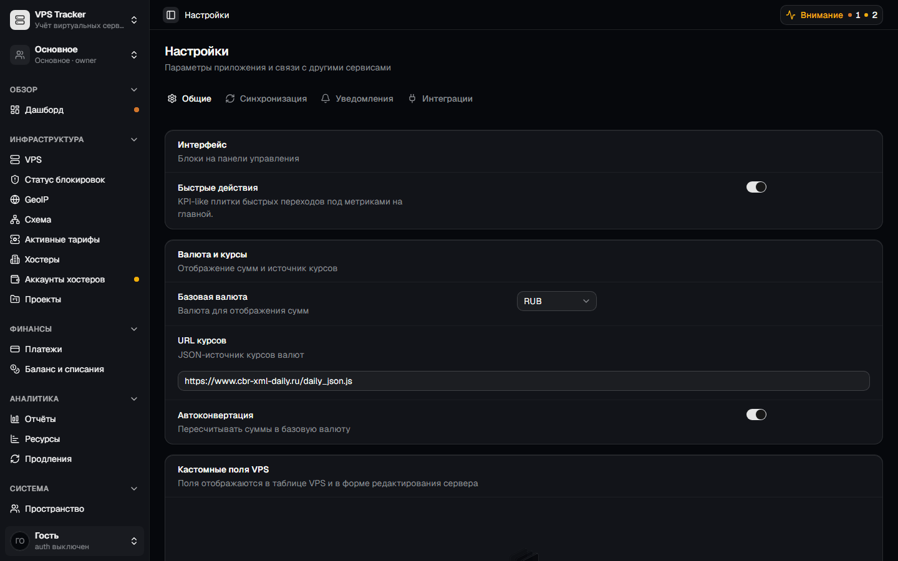 | 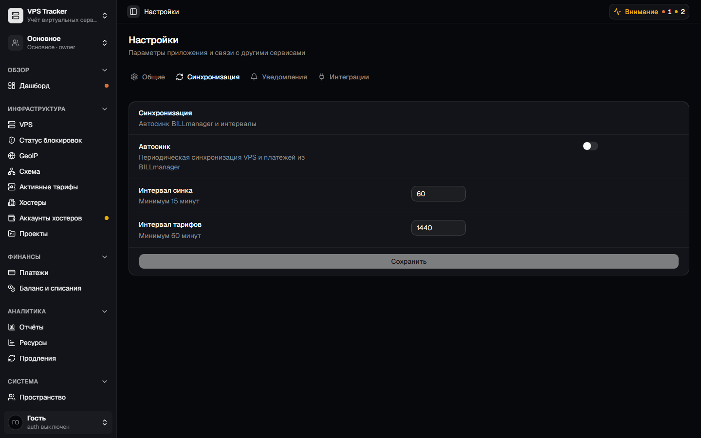 |

- **Общие** — быстрые действия на дашборде, базовая валюта, URL курсов и автоконвертация, произвольные поля VPS, **бэкап/восстановление** (JSON или файл БД).
- **Синхронизация** — автосинк и интервалы.
- **Уведомления** — Telegram, webhook и выбор событий.
- **Интеграции** — **App Switcher** (переключатель приложений в шапке) и **CF Domain Manager (CFDM)**: домены и балансировщики из CFDM подтягиваются каждые 15 минут и показываются у VPS и на схеме.

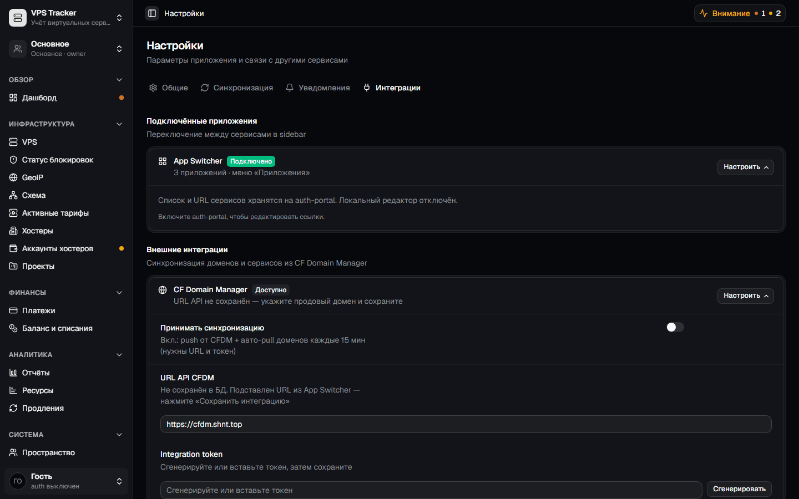

Работает и на телефоне — меню сворачивается, таблицы прокручиваются:

<p align="center">
  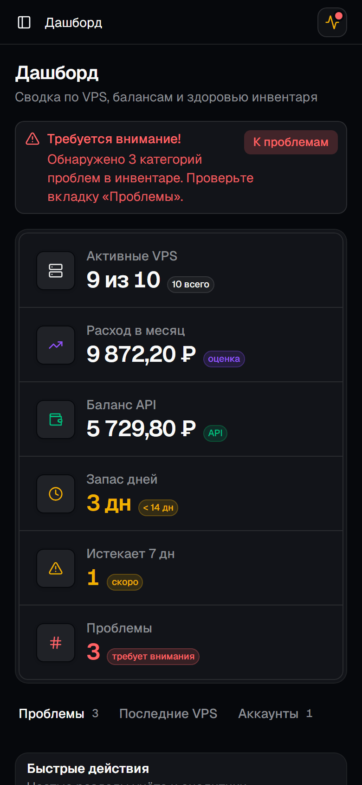
  &nbsp;
  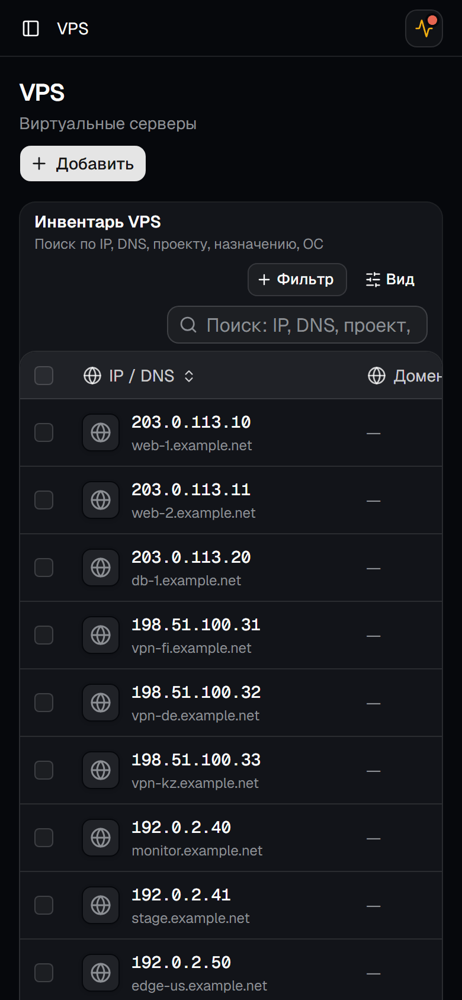
</p>
